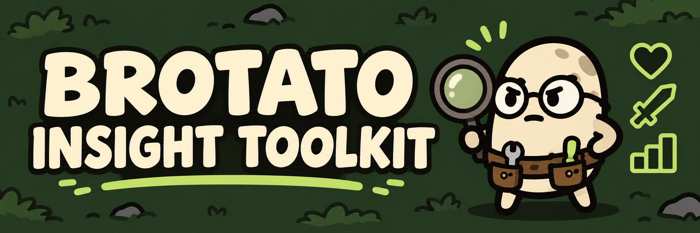

<p align="center">
	
	<a href="README.ru.md"></a>
</p>


<p align="center">
  
</p>

<p align="center">
  
</p>

<h3 align="center">Combat stats, build advice and a cleaner interface</h3>

A mod for the Steam version of **Brotato**, with features you can toggle individually.

[Features](#features) · [Settings](#settings) · [Controls](#controls) · [Build](#build) · [Development](#development)

## Features

| Area | What the mod adds |
| --- | --- |
| **Combat stats** | Per-weapon damage, identical weapons grouped into one row, and comparison with the previous wave. A separate tab tracks kills, damage dealt and damage taken by enemy type. |
| **Build advice** | Recommendations for purchases, level-ups, rerolls and sales based on your character and current build. On the level-up screen, advice appears beside the focused card. |
| **Stat previews** | Resulting stats after a purchase, indirect changes from other items, bonus sources and thresholds. |
| **Readable UI** | Wider tooltips, compact icons, short stat names and abbreviated large numbers: `12.5k`, `1.2kk`, `3kkk`. |
| **Russian localization** | Corrected descriptions and shorter Russian stat names. The standard wording can be restored in settings. |
| **Quality of life** | Newest-first Tumor upgrades, unread upgrade markers, ×1–×4 wave speed, a fixed solo camera and weapon range indicators. |

The damage difference appears once the current total exceeds the previous wave's total, or during the final five in-game seconds. Increases are green; decreases are red.

The analyzer estimates combat and reroll outcomes and flags effects it cannot fully account for. Combat history accumulates during the current game session. In co-op, level-up advice remains inside the cards.

## Settings

**In-game options → Gameplay → Brotato Insight Toolkit**

Features can be toggled individually. The mod's custom setting labels currently use Russian:

- **Short numbers** (`Короткие числа`): switch between `12.5k` and the exact value in its normal format.
- **Short names** (`Короткие названия`) and **Corrected translation** (`Исправленный перевод`): independent localization settings.
- **Resulting stats** (`Итоговые значения статов`): preview purchases and level-ups.
- **Choice analyzer** (`Анализатор выбора`): recommendations; disabled by default.
- **Wide tooltips** (`Широкие подсказки`), **Enemy stats** (`Статистика крипов`) and **Weapon damage HUD** (`Урон от оружия на экране`): adjust the interface to your preference.

## Controls

These shortcuts work during an active wave. A brief on-screen message confirms the selected speed or damage-number state.

| Action | Keyboard | DualSense / DualShock 4 |
| --- | --- | --- |
| Decrease speed | `-` | `□` |
| Increase speed | `=` | `△` |
| Show or hide damage numbers | `\` | `○` |

Speed changes the flow of game time: at ×2, a 60-second wave takes approximately 30 real seconds.

## Build

A local build for the Steam version of Brotato. Requires **Bash** and **ZIP**.

Close the game through its menu before replacing the mod archive:

```sh
./build.sh
```

The script builds a ZIP and copies it into the local folder of an existing Workshop subscription. Override the destination with `WORKSHOP_ITEM` or `OUT_DIR`.

To build **without installing into the game**:

```sh
mkdir -p /tmp/brotato-insight-toolkit-build
OUT_DIR=/tmp/brotato-insight-toolkit-build ./build.sh
```

<details>
<summary>Technical ID and existing settings</summary>

The technical ID `aimuzov-DpsCheck`, archive `dist/aimuzov-DpsCheck.zip` and settings file `user://aimuzov-dpscheck.json` are retained for compatibility with the installed mod.

Project and repository name: `brotato-insight-toolkit`.

</details>

## Development

Requires Python 3 and a separate **Godot 3.7 executable without the game PCK**. The Brotato executable starts the real game and uses its profile, so tests need a separate engine.

```sh
GODOT=/path/to/standalone/Godot python3 tools/check_analyzer.py
GODOT=/path/to/standalone/Godot python3 tools/check_analyzer_game.py
python3 tools/check_localization.py
```

Tests use isolated projects and separate profiles. Game contracts are checked with stubs; actual rendering is verified separately in Brotato. UI fixtures use Arial from the macOS system fonts.
